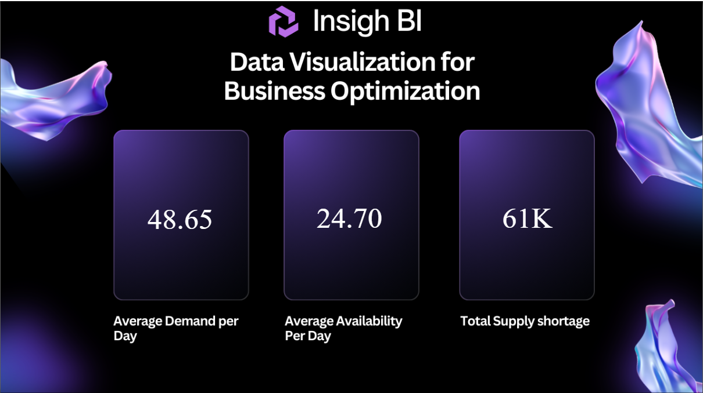

# Inventory Demand & Supply Analysis — Power BI + SQL Server

An end-to-end Power BI report that compares product **demand** with **stock availability** to show where the business is losing sales because of supply shortages, and what that costs in revenue.



## Business question
*Are we keeping enough stock to meet daily demand, and how much profit are we losing when we don't?*

## Tools
- **Microsoft SQL Server (T-SQL)** – loading, joining and preparing the data
- **Power BI Desktop** – data model, DAX measures and report

## Data
| File | Rows | Description |
|---|---|---|
| `data/prod_inventory.csv` | 1,043 | Daily orders 2021–2026: date, product ID, availability, demand |
| `data/test_inventory.csv` | 99 | Smaller sample used to build and test the SQL first |
| `data/products.csv` | 20 | Product name and unit price ($) |

The data is a sample/practice dataset of 20 consumer electronics products (e.g. 4K Smart TV, VR Headset, Smartwatch).

## Process
1. **Test environment first** – built the SQL on the 99-row test dataset in SQL Server before touching the production data.
2. **Join and clean** – combined the inventory table with product details using a `LEFT JOIN`, listing columns explicitly so `Product_ID` appears only once ([`sql/data_preparation.sql`](sql/data_preparation.sql)).
3. **Single clean table** – saved the result with `SELECT … INTO` so Power BI loads one tidy table.
4. **Production report** – applied the same steps to the 1,043-row production dataset and built the report in Power BI.
5. **Measures table** – kept all DAX measures in a dedicated *Measures Table* for a clean model.

## DAX measures
| Page | Measure | What it shows |
|---|---|---|
| Demand & Supply | `Average Demand per day` | Average units customers wanted per day |
| Demand & Supply | `Average Availability per day` | Average units in stock per day |
| Demand & Supply | `Supply Shortage` | Total units of demand that could not be met |
| Profit & Loss | `Total Profit` | Revenue from demand that was met |
| Profit & Loss | `Total Loss` | Revenue lost on unmet demand |
| Profit & Loss | `Average Daily Loss` | Lost revenue per day |

## Report pages
| Page 1 – Demand & Supply | Page 2 – Profit & Loss |
|---|---|
|  |  |

## Key findings
- Demand was higher than available stock on **about 87% of order days** in the production data.
- On average, stock covered only **about half of daily demand** (≈60 units available vs ≈119 demanded per order).
- The biggest revenue losses came from high-priced items – **4K Smart TV, VR Headset and Digital Camera** – so restocking these first would recover the most revenue.
- **Data quality check:** product IDs 21 and 22 appear in the inventory data (88 rows) but not in the product table, so they have no price. These rows are kept by the `LEFT JOIN` and should be fixed at source before reporting profit.

## Repository structure
```
├── powerbi/   Inventory_Supply_Report.pbix
├── sql/       data_preparation.sql
├── data/      prod_inventory.csv, test_inventory.csv, products.csv
└── images/    report screenshots and background designs
```

## How to open
Download `powerbi/Inventory_Supply_Report.pbix` and open it in Power BI Desktop (free). To rebuild the data step, import the CSV files into SQL Server and run `sql/data_preparation.sql`.

---
**Author:** Vaishali Kedare · [LinkedIn](https://www.linkedin.com/in/vaishali-kedare-8a8b67215) · [GitHub](https://github.com/vaishalikedare)
